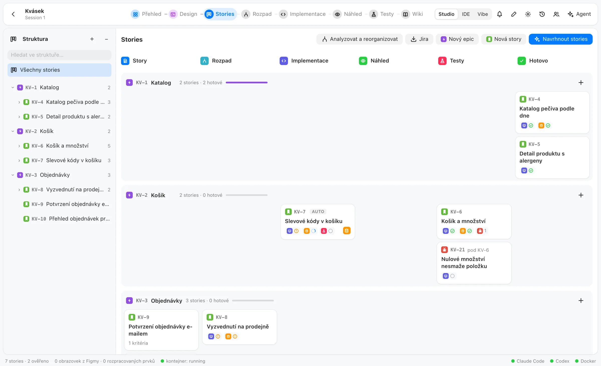
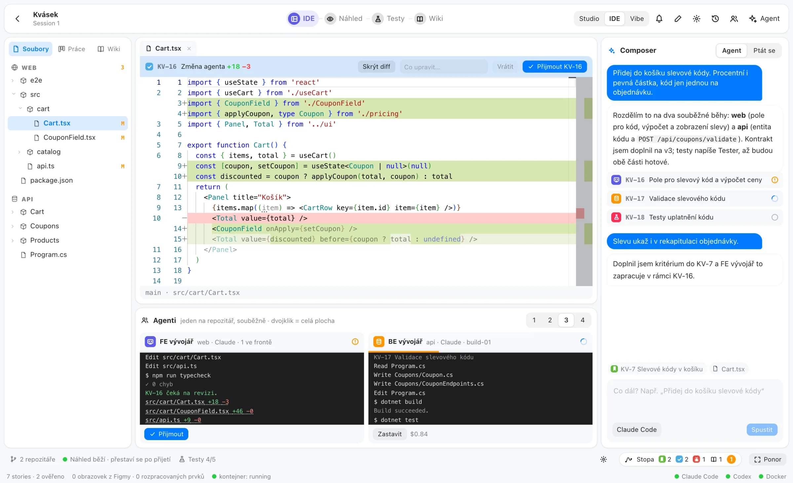

<div align="center">


# Reactor

**From a design to tested software. With a team of agents you review.**

A self-hosted AI studio for software houses: Figma design, epics and stories, a breakdown into tasks per repository, Claude Code and Codex implementing them side by side, a live container preview, Playwright tests that file their own bugs and a wiki for people. Plus an agentic IDE that keeps the backlog written for you.

[](https://github.com/DanielHromadka/aforge/actions/workflows/ci.yml)
[](LICENSE)
[](https://nodejs.org/)
[](https://www.typescriptlang.org/)
[](https://react.dev/)
<br>
[](#agents-on-your-own-servers)
[](https://www.docker.com/)

[**Get started**](#get-started) · [Website](https://danielhromadka.github.io/aforge/) · [Architecture](docs/ARCHITECTURE.md) · [Report a bug](https://github.com/DanielHromadka/aforge/issues/new) · [Čeština](README.cs.md)



</div>

## Get started

You need Node.js 22+, Docker (Docker Desktop or OrbStack) for the preview and tests, and a signed-in [Claude Code](https://code.claude.com) (`claude`); [Codex](https://developers.openai.com/codex) (`codex`) is optional.

```bash
git clone https://github.com/DanielHromadka/aforge.git
cd aforge
npm install
npm run runtime:build      # once: the aforge-runtime image (Ubuntu 24.04, Node 22, .NET 8, Python 3, Nginx)
AFORGE_AUTH=off npm run dev # server :4310 + web http://localhost:5310, one local administrator
```

With sign-in: `npm run keycloak` starts Keycloak with the `aforge` realm on :8380, then `npm run dev` and sign in as `admin` / `admin` or `developer` / `developer` (local development accounts only). Production on one Linux server, with Cloudflare Tunnel, backups and sandboxed agents: [deploy/production/INSTALL.md](deploy/production/INSTALL.md).

The UI is in Czech. The complete feature reference is [README.cs.md](README.cs.md).

## Features

### Work flows by story
- **Jira-like work**: epic → story → task, bug and sub-task, with keys like `KV-7` in one numbering. A header ladder of steps (Overview, Design, Stories, Breakdown, Implementation, Preview, Tests, Wiki) that is also the navigation, one colour and icon per step everywhere.
- **Design from Figma**: frames become screens and layers become elements; notes, linked stories and a *being worked on* flag live beside them.
- **Analyst** proposes epics and stories with Given/When/Then criteria; *Analyse and reorganise* reviews a backlog before implementation (merge, split, move, clarify) with every original criterion accounted for.
- **Architect** breaks stories into frontend, backend and test tasks for the right repository and keeps one **OpenAPI contract** written into every repository.
- **One agent per repository**, repositories in parallel: follow the run as a timeline, open the changed files side by side, then **accept** or **return** the task with a comment.
- **Preview** in an isolated container with Lovable-style **annotations**: a note on an element of the running app is a bug.
- **Playwright tests** map to stories by `[KEY-n]` in their title; a failing test opens a bug and passing again closes it; walkthroughs are recorded as video.
- **Wiki for people**: after green tests the Documenter proposes what each feature does, how, and its rules.
- **Planning for people**: estimates, notes, reminders and deadlines that no agent ever sees.

### The agentic IDE


- **Composer** (<kbd>⌘L</kbd>) plans a prompt into tasks per repository in one call and starts their agents; follow-ups queue behind the running run. *Ask* mode is the consultant.
- **Editor** (Monaco) with the agent's inline diff, accept or return in place, and <kbd>⌘K</kbd> to send a selection straight to its repository's agent.
- **The Scribe** writes the backlog from what you ask: a new topic becomes a story (and an epic), a follow-up adds criteria, a technical change stays a task, and an unsure prompt waits *unsorted* instead of being guessed.
- **The trace** (<kbd>⌘⇧T</kbd>) shows what the Scribe and the Documenter wrote from every prompt; every *AUTO* record can be reverted, and the board marks such stories.
- **Ponor** (<kbd>⌘⇧↩</kbd>), the immersive mode: only the running app and one prompt line; click an element to talk about it.
- Switch any session between **Studio**, **IDE** and **Vibe coding** at any time; every story, task and prompt stays.

### Agents on your own servers
- **Workers** run where Claude Code or Codex is signed in on a subscription, connect *out* to a relay (no open ports) and exchange end-to-end encrypted messages (ChaCha20-Poly1305, one key per worker).
- **Pipeline**: an orchestrator plans the work by phases with dependencies; the hub hands independent tasks to free workers by capability, label and load.
- **Runs and usage**: one list of local and remote runs with model, worker, step, duration, context and reported tokens and cost.

### You stay in charge
- Agents **propose**, people decide: consultant answers are proposals to accept or reject, and code always waits for review.
- Everything has a way back: git commits, versioned descriptions and wiki pages, revertible Scribe records, sessions and read-only snapshots.
- Previews, tests and production agents run in bounded containers with filtered outbound networking, never with the host's environment or Docker socket.
- Projects are plain JSON and git repositories in `data/`, on your own server, with Keycloak roles (owner, editor, viewer).

## Building

```bash
npm run typecheck   # the main gate: shared, protocol, runner, server, relay, worker, web
npm test            # vitest
npm run build       # the web app; npm start -w @aforge/server serves it on :4310
npm run release     # the tested deployable artifact in .releases/
```

| Path | What it is |
|---|---|
| `packages/shared` | the domain model and the zod schemas of the agent contract |
| `packages/protocol`, `packages/runner` | the hub ⇄ relay ⇄ worker wire format; headless Claude Code / Codex runs |
| `apps/server` | Fastify API, agents, builds, preview, tests, the IDE's Scribe |
| `apps/web` | the React editor |
| `apps/relay`, `apps/worker` | the relay and the `aforge-worker` daemon |
| `website/` | the website, published by GitHub Pages |

More in [docs/ARCHITECTURE.md](docs/ARCHITECTURE.md) and [CLAUDE.md](CLAUDE.md).

## Security

Please report vulnerabilities privately, see [SECURITY.md](SECURITY.md).

## License

[GPL-3.0-or-later](LICENSE).
